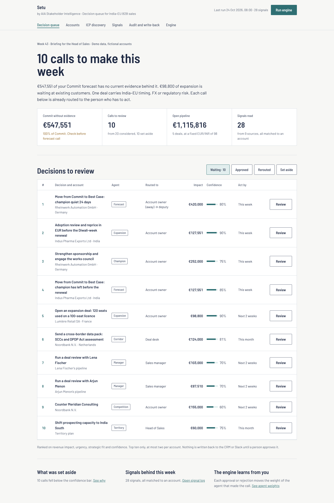
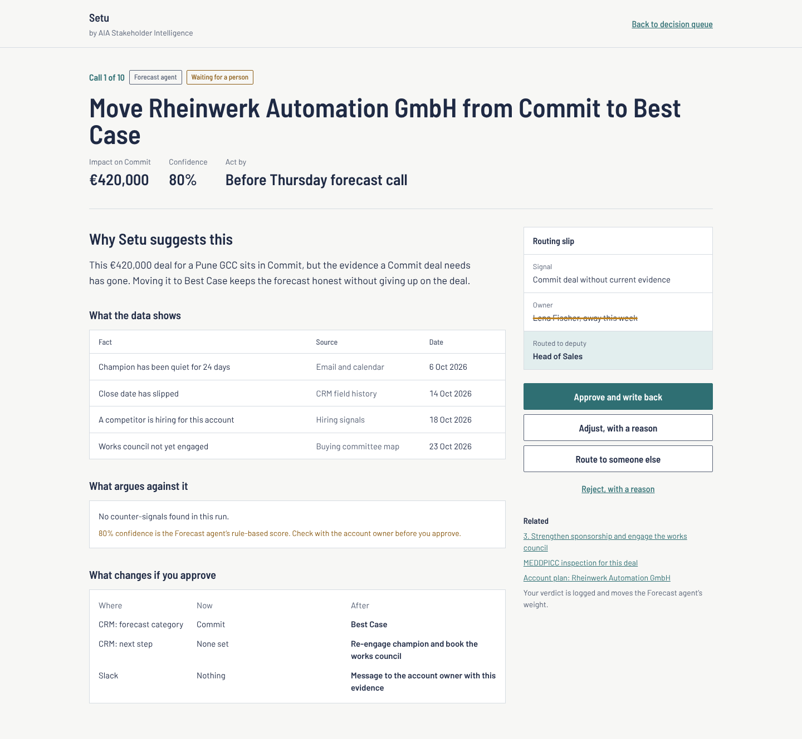
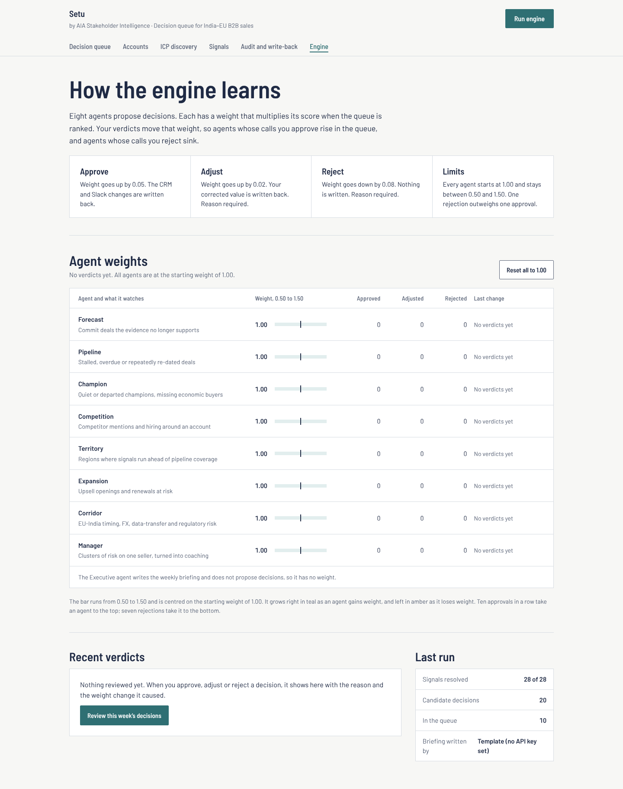

# Setu redesign (October 2026)

Designed, not yet built. The running prototype still uses the original interface in `web/`. All accounts, people and figures are fictional demo data from `engine/seed.py`, taken from one engine run.

## 1. Decision queue

The home screen answers one question for a Head of Sales: which calls do I make this week? Up to ten decisions, ranked on revenue impact, urgency, strategic fit and confidence, at most two per account. Each row shows the agent that proposed it, who it is routed to, the impact, the confidence and an act-by date in place of a raw urgency percentage.

## 2. Decision detail with routing slip

One decision with the evidence behind it (fact, source, date), what argues against it, and a before-and-after view of every CRM field and Slack message that would change on approval. The routing slip shows the owner and, when the owner is away, the deputy who gets the call instead. Approve, adjust, reroute or reject; adjust and reject need a reason.

## 3. Engine: agent weights and learning loop

Eight agents propose decisions and each carries a weight that multiplies its score in the ranking. Approve adds 0.05, adjust adds 0.02, reject takes off 0.08, and every weight stays between 0.50 and 1.50, so one rejection outweighs one approval. The Executive agent writes the weekly briefing and has no weight.

## What changes from the current interface
- Owner and deputy on every decision (new; needs an owner field from the CRM and a deputy table)
- "Act by" replaces the urgency percentage
- One tag style for all agents
- Write-back preview before approval
- Agent weights get their own Engine tab
